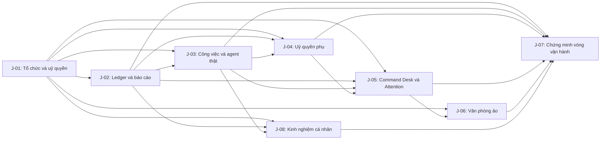

# Jobs — AI Corp

- **Document ID:** `AIC-JOB-20261106-01`
- **Created:** 2026-11-06 (Asia/Bangkok)
- **Last updated:** 2026-11-06 (Asia/Bangkok)
- **Brief referenced:** [`brief.md`](brief.md) — `AIC-BRF-20261105-01`
- **Ideas referenced:** [`ideas.md`](ideas.md) — `AIC-IDE-20261106-01`
- **Trạng thái:** CEO đã duyệt để phân rã thành Task ngày 2026-11-06 (Asia/Bangkok). J-01 được nghiệm thu hoàn tất chính thức ngày 2026-11-07 (Asia/Bangkok) tại `AcceptanceReport-J01-Final`.
- **Task plan:** [`Tasks.md`](Tasks.md) — `AIC-TSK-20261106-01`
- **Architecture baseline (CEO bổ sung 2026-11-06):** Tauri + React/TypeScript + Rust + SQLite. React/TypeScript phục vụ giao diện; Rust/Tauri sở hữu domain, quyền, connector và persistence; SQLite là local store. Không Job nào được để UI ghi trực tiếp vào ledger hay truy cập secret/runtime không qua Rust.

## 1. Mục đích và ranh giới

Tài liệu này chuyển các idea đã duyệt thành những **Job lớn** để hiện thực hoá AI Corp. Một Job là một mảng kết quả vận hành hoàn chỉnh, không phải một tập hợp việc lặt vặt. Phân rã thực thi chi tiết chỉ diễn ra trong tài liệu Task sau khi CEO duyệt Job.

Mỗi Job phải:

- dẫn về ít nhất một idea trong `ideas.md`;
- xác định đầu vào, gồm Job tiền nhiệm nếu có;
- có đúng một việc chính ở mức lớn;
- tạo đầu ra có thể kiểm tra;
- chỉ rõ Job nào sẽ dùng đầu ra đó.

Không Job nào được ngầm thêm các hướng chưa ưu tiên: Thư ký AI, đa chi nhánh, heartbeat tự trị, marketplace, thanh toán hay văn phòng 3D/game hoá.

## 2. Các idea mà Jobs này hiện thực hoá

| ID idea | Tên idea | Job thực hiện |
| --- | --- | --- |
| I-01 | CEO Command Desk | J-05 |
| I-02 | Hồ sơ Nhân viên AI bền vững | J-01 |
| I-03 | Hộp uỷ quyền | J-01, J-04 |
| I-04 | Công việc như một hợp đồng có thể kiểm tra | J-03 |
| I-05 | Báo cáo điều hành là artifact mặc định | J-02, J-03 |
| I-06 | Sổ cái điều hành | J-02 |
| I-07 | Cây công việc phụ có thể mở theo yêu cầu | J-04 |
| I-08 | Văn phòng ảo như bản đồ trạng thái sống | J-06 |
| I-09 | Hàng đợi CEO Attention | J-05 |
| I-10 | Lớp kết nối agent thật, thay thế được | J-03 |
| I-11 | Kinh nghiệm cá nhân có nguồn của Nhân viên AI | J-08 |

## 3. Quy ước phụ thuộc

- `J-x → J-y` nghĩa là Job `J-y` chỉ được bắt đầu sau khi đầu ra của `J-x` đã được nghiệm thu.
- Một Job không được nhận đầu vào bằng giả định, dữ liệu mẫu không truy nguyên được hoặc trạng thái tự nhận của agent.
- “Có thể kiểm tra” nghĩa là CEO có thể quan sát trực tiếp dữ liệu, giao diện, artifact hoặc bằng chứng thực thi tương ứng; không chỉ có mô tả trong tài liệu.

## 4. Danh sách Job

### J-01 — Nền tảng tổ chức, nhân viên và uỷ quyền

- **Ideas hiện thực hoá:** I-02 Hồ sơ Nhân viên AI bền vững; phần nền của I-03 Hộp uỷ quyền.
- **Đầu vào:** `brief.md` đã duyệt; `ideas.md` đã duyệt; không có Job tiền nhiệm.
- **Việc chính:** Thiết lập mô hình tổ chức AI Corp để CEO có thể tạo và duy trì nhân viên AI có danh tính, chức vụ, tuyến báo cáo và Hộp uỷ quyền theo ngữ cảnh.
- **Đầu ra có thể kiểm tra:** CEO tạo được một tổ chức với hồ sơ nhân viên AI; từng hồ sơ hiển thị rõ tên, chức vụ, runtime được gắn, cấp quản lý, trạng thái, lịch sử rỗng ban đầu và Hộp uỷ quyền. Hộp này thể hiện ít nhất phạm vi công việc, thời gian, ngân sách/quota, quyền thao tác, quyền giao việc phụ và quyền tự duyệt. CEO có thể cấp, thu hẹp, thu hồi và xem lịch sử thay đổi quyền.
- **Đầu ra chuyển cho:** J-02 dùng danh tính/quyền để ghi nguồn sự kiện; J-03 dùng nhân viên và Hộp uỷ quyền khi chạy agent; J-04 dùng quyền giao việc phụ; J-05 dùng hồ sơ/trạng thái để điều hành; J-06 dùng tổ chức và tuyến báo cáo để dựng bản đồ văn phòng; J-08 dùng hồ sơ nhân viên làm chủ thể của kinh nghiệm.

### J-02 — Sổ cái bất biến và báo cáo điều hành

- **Ideas hiện thực hoá:** I-05 Báo cáo điều hành là artifact mặc định; I-06 Sổ cái điều hành.
- **Đầu vào:** Kết quả J-01 đã hoàn thành: danh tính nhân viên, tổ chức và Hộp uỷ quyền có thể đọc được.
- **Việc chính:** Xây dựng nguồn sự thật điều hành chỉ-ghi-thêm, ghi tự động các sự kiện quan trọng và lưu báo cáo/artifact theo cách CEO có thể xem, duyệt hoặc yêu cầu sửa.
- **Đầu ra có thể kiểm tra:** Khi có sự kiện điều hành, hệ thống tạo bản ghi ledger mang thời điểm, tác nhân/nguồn, loại sự kiện, ngữ cảnh và liên kết liên quan. Bản ghi cũ không thể sửa/xoá bởi CEO hay agent; một sai sót chỉ tạo được bản đính chính mới liên kết bản gốc và có lý do. Một báo cáo điều hành hiển thị sáu phần đã duyệt: nhiệm vụ/việc đã làm, kết quả, bằng chứng/artifact, điều chưa chắc/bị chặn/cần CEO, công việc phụ cùng uỷ quyền, và đề xuất bước tiếp theo tách khỏi việc đã hoàn thành.
- **Đầu ra chuyển cho:** J-03 ghi phiên thực hiện, báo cáo và artifact vào ledger; J-04 truy nguyên uỷ quyền/công việc phụ; J-05 dựng Attention và Command Desk từ các sự kiện/báo cáo; J-08 rút kinh nghiệm có nguồn từ báo cáo/artifact/ledger; J-07 dùng làm bằng chứng nghiệm thu vòng vận hành.

### J-03 — Công việc kiểm chứng được và kết nối agent thật đầu tiên

- **Ideas hiện thực hoá:** I-04 Công việc như một hợp đồng có thể kiểm tra; I-10 Lớp kết nối agent thật, thay thế được; phần tạo báo cáo của I-05.
- **Đầu vào:** Kết quả J-01 đã hoàn thành: nhân viên và Hộp uỷ quyền; kết quả J-02 đã hoàn thành: ledger bất biến và định dạng báo cáo/artifact.
- **Việc chính:** Cho một nhân viên AI thật nhận một công việc có hợp đồng rõ ràng, thực hiện qua một connector runtime đầu tiên và bàn giao báo cáo/artifact có bằng chứng.
- **Đầu ra có thể kiểm tra:** CEO tạo được công việc với mục tiêu, đầu vào, người chịu trách nhiệm, giới hạn quyền, điều kiện hoàn thành và yêu cầu báo cáo. Hệ thống phân biệt được các trạng thái “đã gửi lệnh”, “runtime đang chạy”, “runtime phản hồi”, “đã tạo báo cáo” và “đã được CEO duyệt/yêu cầu sửa”. Một agent thật hoàn tất một kịch bản công việc có báo cáo và artifact có thể mở/kiểm tra; các bước và kết quả được ghi vào ledger.
- **Đầu ra chuyển cho:** J-04 dùng công việc thật để tạo/giám sát công việc phụ; J-05 dùng trạng thái, báo cáo và blocker thật cho bàn điều hành; J-08 rút và sử dụng kinh nghiệm qua công việc thật; J-07 dùng vòng làm việc thật làm bằng chứng tích hợp.

### J-04 — Uỷ quyền phụ và giám sát cây công việc

- **Ideas hiện thực hoá:** phần thực thi của I-03 Hộp uỷ quyền; I-07 Cây công việc phụ có thể mở theo yêu cầu.
- **Đầu vào:** Kết quả J-01 đã hoàn thành: quyền giao việc phụ/tự duyệt; J-02 đã hoàn thành: ledger bất biến và báo cáo; J-03 đã hoàn thành: công việc với agent thật và trạng thái có thể kiểm tra.
- **Việc chính:** Hiện thực hoá cơ chế nhân viên được uỷ quyền có thể tạo, theo dõi và tổng hợp công việc phụ trong giới hạn do CEO cấp, đồng thời CEO luôn có quyền can thiệp.
- **Đầu ra có thể kiểm tra:** Khi Hộp uỷ quyền cho phép, một nhân viên tạo được công việc phụ có liên kết cha-con và ghi rõ lý do, giới hạn quyền, người giao/người nhận, tiến độ và kết quả. Cây được mặc định thu gọn nhưng CEO có thể mở toàn bộ; CEO có thể yêu cầu giải trình, thu hồi uỷ quyền hoặc chuyển sang duyệt trước, và hệ thống chặn/đưa vào chờ duyệt mọi việc phụ mới theo chỉ thị đó. Người quản lý AI có thể tổng hợp các nhánh vào báo cáo.
- **Đầu ra chuyển cho:** J-05 hiển thị các tín hiệu cần CEO chú ý mà không làm tràn màn hình; J-07 xác minh CEO có thể truy nguyên và can thiệp trong vòng vận hành.

### J-05 — Bàn điều hành CEO và hàng đợi Attention

- **Ideas hiện thực hoá:** I-01 CEO Command Desk; I-09 Hàng đợi CEO Attention.
- **Đầu vào:** Kết quả J-01 đã hoàn thành: tổ chức/nhân viên/quyền; J-02 đã hoàn thành: ledger/báo cáo; J-03 đã hoàn thành: trạng thái công việc và agent thật; J-04 đã hoàn thành: công việc phụ có thể truy nguyên.
- **Việc chính:** Cung cấp bề mặt điều hành chính để CEO nhìn tình hình, thực hiện quyết định và chỉ nhận các mục thực sự cần hành động.
- **Đầu ra có thể kiểm tra:** Một Command Desk trả lời được “đội đang làm gì, điều gì cần CEO, kết quả nào chờ duyệt”. CEO thấy trạng thái nhân viên/công việc, blocker, báo cáo chờ xem và yêu cầu quyền/duyệt; mỗi tín hiệu mở được hồ sơ hoặc ledger liên quan. CEO Attention chỉ nhận các mục cần phản hồi rõ ràng (duyệt/từ chối, cấp/thu quyền, chọn hướng, xem báo cáo, giải quyết blocker/lỗi), có lý do và hành động; sự kiện không cần quyết định nằm ở ledger/báo cáo.
- **Đầu ra chuyển cho:** J-06 liên kết bản đồ văn phòng với đúng bề mặt điều hành; J-07 dùng để chứng minh CEO có thể điều hành vòng làm việc mà không cần theo dõi log thô.

### J-06 — Bản đồ văn phòng đơn tầng và đa tầng

- **Ideas hiện thực hoá:** I-08 Văn phòng ảo như bản đồ trạng thái sống.
- **Đầu vào:** Kết quả J-01 đã hoàn thành: tổ chức, nhân viên, chức vụ và tuyến báo cáo; J-05 đã hoàn thành: Command Desk là bề mặt điều hành thật.
- **Việc chính:** Tạo bản đồ văn phòng trực quan cho hai cấu trúc quy mô đầu tiên — đơn tầng và đa tầng — từ cùng nguồn dữ liệu tổ chức/điều hành của AI Corp.
- **Đầu ra có thể kiểm tra:** CEO chọn được văn phòng đơn tầng hoặc đa tầng. Bản đồ hiển thị nhân viên theo vị trí/nhóm/bộ phận/tầng quản lý cùng trạng thái có nhãn, biểu tượng và mô tả; không chỉ dùng màu. Từ bất kỳ nhân viên hoặc khu vực nào, CEO mở được đúng hồ sơ, công việc, báo cáo hay quyết định tương ứng trên Command Desk. Cùng một thay đổi trạng thái có ý nghĩa nhất quán trên Command Desk và văn phòng. Không bao gồm đa chi nhánh/Branch Director ở Job này.
- **Đầu ra chuyển cho:** J-07 dùng để xác minh văn phòng là bản đồ của trạng thái thật, không phải dữ liệu minh hoạ tách rời.

### J-08 — Kinh nghiệm cá nhân có nguồn cho Nhân viên AI

- **Ideas hiện thực hoá:** I-11 Kinh nghiệm cá nhân có nguồn của Nhân viên AI.
- **Đầu vào:** Kết quả J-01 đã hoàn thành: hồ sơ nhân viên, tổ chức và Hộp uỷ quyền; J-02 đã hoàn thành: ledger bất biến, báo cáo và artifact có nguồn; J-03 đã hoàn thành: công việc/phiên thực hiện với agent thật.
- **Việc chính:** Trang bị cho mỗi nhân viên một lịch sử kinh nghiệm bền vững, có nguồn và có thể chọn lọc làm bối cảnh cho công việc sau mà không làm lẫn kinh nghiệm với sự thật trong ledger.
- **Đầu ra có thể kiểm tra:** Mỗi nhân viên có một hồ sơ kinh nghiệm riêng. Một mục kinh nghiệm ghi được bài học, phạm vi áp dụng, nguồn báo cáo/artifact/ledger, thời điểm, trạng thái hiệu lực và nguồn tạo/xác nhận. CEO mở được nguồn của từng mục, yêu cầu đính chính hoặc vô hiệu hoá qua bản ghi mới; bản ghi ledger nguồn không bị thay đổi. Khi agent nhận công việc mới, hệ thống chứng minh được chỉ những kinh nghiệm liên quan được đưa vào bối cảnh; không tự đổi quyền hoặc tự chấm điểm năng lực dựa trên kinh nghiệm.
- **Đầu ra chuyển cho:** J-05 có thể dẫn CEO từ hồ sơ nhân viên tới kinh nghiệm có nguồn; J-07 dùng để chứng minh kinh nghiệm được dùng đúng ranh giới trong vòng vận hành thực.

### J-07 — Chứng minh vòng điều hành AI Corp có bằng chứng

- **Ideas hiện thực hoá:** kiểm chứng tích hợp cho I-01 đến I-11; không thêm idea mới.
- **Đầu vào:** Kết quả J-02 đến J-06 và J-08 đã hoàn thành: ledger/báo cáo, agent thật/công việc, uỷ quyền phụ, Command Desk/Attention, văn phòng ảo và kinh nghiệm cá nhân có nguồn.
- **Việc chính:** Chứng minh một vòng điều hành khép kín hoạt động với dữ liệu và agent thật, theo đúng brief, bao gồm cả trường hợp CEO cần can thiệp.
- **Đầu ra có thể kiểm tra:** Có bằng chứng chạy thực cho kịch bản: CEO tạo/giao công việc → agent thật làm trong Hộp uỷ quyền → có báo cáo/artifact và ledger bất biến → CEO duyệt hoặc yêu cầu sửa; kịch bản có ít nhất một công việc phụ được uỷ quyền hoặc một yêu cầu CEO buộc duyệt trước. Một kinh nghiệm có nguồn được tạo hoặc xác nhận từ kết quả thực và được đưa có chọn lọc vào công việc kế tiếp của cùng nhân viên. CEO kiểm tra được toàn bộ chuỗi trên Command Desk, mở được cây công việc/ledger, và thấy đúng trạng thái trên văn phòng đơn tầng hoặc đa tầng. Bằng chứng phải phân biệt rõ sự kiện thực với dữ liệu minh hoạ/mô phỏng.
- **Đầu ra chuyển cho:** Đây là điểm hoàn thành của phạm vi Job hiện tại; kết quả là đầu vào cho giai đoạn CEO duyệt MVP hoặc chọn ý tưởng phát triển sau.

## 5. Sơ đồ kế thừa Job

## 6. Tiêu chuẩn duyệt Jobs để sang Task

Jobs sẵn sàng được phân rã thành Task khi CEO xác nhận rằng:

- tám Job trên bao quát tất cả idea I-01 đến I-11 mà không tự thêm phạm vi ngoài brief;
- quan hệ kế thừa phản ánh đúng thứ tự cần có của đầu vào/đầu ra;
- đầu ra của từng Job là kết quả CEO có thể tự kiểm tra, không chỉ là mô tả kỹ thuật;
- Job chưa bị chia nhỏ thành thao tác triển khai; những thao tác đó sẽ nằm trong Task;
- J-07 là điều kiện chứng minh cuối, không bị thay bằng build thành công hoặc log tự nhận của agent.

Chỉ sau khi CEO duyệt Jobs, mỗi Job mới được phân rã thành một hoặc nhiều Task có tiêu chí hoàn thành, cách kiểm chứng và phụ thuộc cụ thể.
